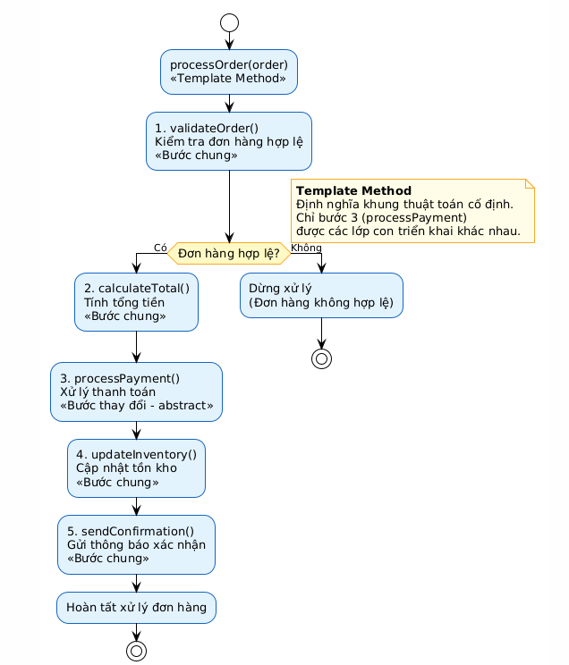
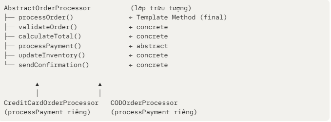
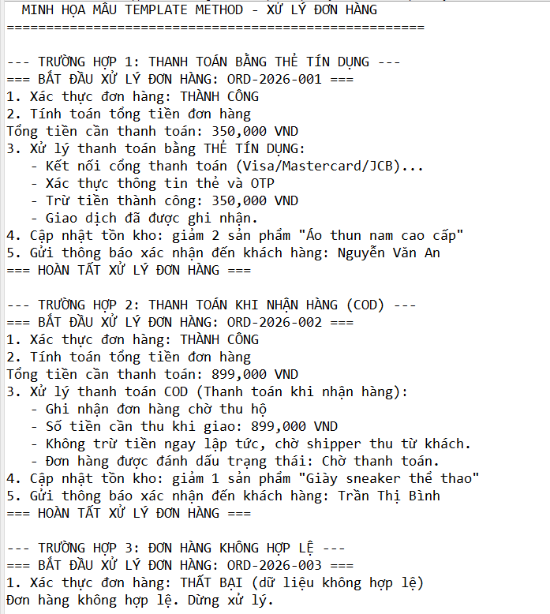

README – Mẫu thiết kế Template Method
Xử lý đơn hàng (Order Processing)

1. Tổng quan
   Chương trình minh họa mẫu Template Method trong Java.
   Quy trình xử lý đơn hàng được định nghĩa sẵn trong lớp trừu tượng AbstractOrderProcessor.
   Các lớp con chỉ cần triển khai phần khác biệt (xử lý thanh toán).

Hai trường hợp chính:

Thanh toán bằng Thẻ tín dụng
Thanh toán khi nhận hàng (COD) 2. Luồng hoạt động chung (Template Method)
Phương thức processOrder(Order order) định nghĩa khung thuật toán cố định:

Chi tiết từng bước
Bước Tên phương thức Loại Mô tả
1 validateOrder() Chung Kiểm tra amount > 0 và quantity > 0
2 calculateTotal() Chung amount × quantity
3 processPayment() Thay đổi Logic thanh toán khác nhau theo lớp con
4 updateInventory() Chung Giảm số lượng sản phẩm trong kho
5 sendConfirmation() Chung Gửi thông báo xác nhận cho khách hàng 3. Luồng cụ thể theo từng trường hợp
3.1. Luồng Thanh toán Thẻ tín dụng
(CreditCardOrderProcessor)

validateOrder() → THÀNH CÔNG
calculateTotal() → Tính tổng tiền
processPayment() →
• Kết nối cổng thanh toán (Visa/Mastercard/JCB)
• Xác thực thẻ + OTP
• Trừ tiền ngay lập tức
• Ghi nhận giao dịch thành công
updateInventory() → Giảm tồn kho
sendConfirmation() → Gửi email/SMS xác nhận
Đặc điểm: Tiền được trừ ngay khi xử lý đơn hàng.

3.2. Luồng Thanh toán COD
(CODOrderProcessor)

validateOrder() → THÀNH CÔNG
calculateTotal() → Tính tổng tiền
processPayment() →
• Ghi nhận đơn hàng chờ thu hộ
• Không trừ tiền ngay
• Đánh dấu trạng thái: "Chờ thanh toán"
• Shipper sẽ thu tiền khi giao hàng
updateInventory() → Giảm tồn kho
sendConfirmation() → Gửi email/SMS xác nhận
Đặc điểm: Không trừ tiền ngay. Khách thanh toán khi nhận hàng.

3.3. Luồng Đơn hàng không hợp lệ
validateOrder() → THẤT BẠI
→ Dừng ngay, không thực hiện các bước còn lại 
4. Cấu trúc lớp

5. Lợi ích của Template Method trong bài này
   Các bước chung chỉ viết một lần
   Thêm phương thức thanh toán mới chỉ cần tạo lớp con mới
   Không được thay đổi thứ tự các bước (vì processOrder là final)
   Dễ bảo trì và mở rộng

6. Kết quả chạy

